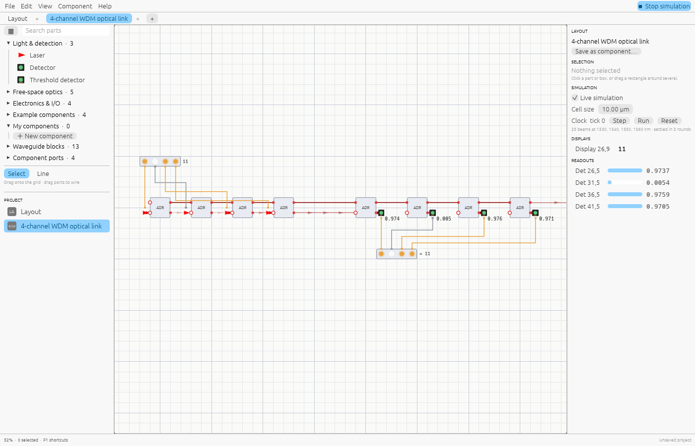

# Shine

Design and simulate photonic circuits: free-space optics, waveguide components, and the
electronics that drive and read them. Light is solved exactly (interference, resonances,
several wavelengths at once); reusable components nest; registers, a clock and function
cells close the loop.

- **Use it in the browser:** <https://shine.lupyd.com/app>
- **Download for Linux, Windows or macOS:** [releases](https://github.com/ash-hashtag/shine/releases)
- **Documentation:** [`docs/`](docs/README.md), also at <https://shine.lupyd.com/docs>
  and as plain text for language models at <https://shine.lupyd.com/llms-full.txt>



## What's inside

- **Editor** (`shine`): one grid for free-space parts, component boxes, waveguides and
  signal wires, with Blender-style controls. See [Getting started](docs/getting-started.md).
- **MCP server** (`shine-mcp`): lets AI assistants build, simulate and save circuits. See
  [AI assistants](docs/ai.md).
- **Library** (`shine::photonics`): the simulator on its own, with SIMD kernels and
  compiled circuits. See [Rust library](docs/library.md).

## Build from source

```sh
cargo run --release                   # the editor
cargo run --release --bin shine-mcp   # the MCP server
cargo test                            # tests, including headless UI and docs checks
scripts/build-web.sh                  # the website, docs and WebAssembly app
```

More in [Development](docs/development.md): the website, screenshots, keeping the docs
current, CI and releases.

## License

Shine is free software under the GNU General Public License, version 3
(`GPL-3.0-only`): you may use, study, share and change it, and what you share must stay
under the same licence. See [LICENSE](LICENSE). Versions up to 0.1.1 were released under
the MIT licence.

The handwritten digits in `reference/digits` are from the UCI Machine Learning Repository
(Alpaydin & Kaynak, 1998), under CC BY 4.0. The chip
`reference/mnist/fashion-mnist-chip.shine` was trained on Fashion-MNIST (Xiao, Rasul &
Vollgraf, Zalando Research, 2017), under the MIT licence.
