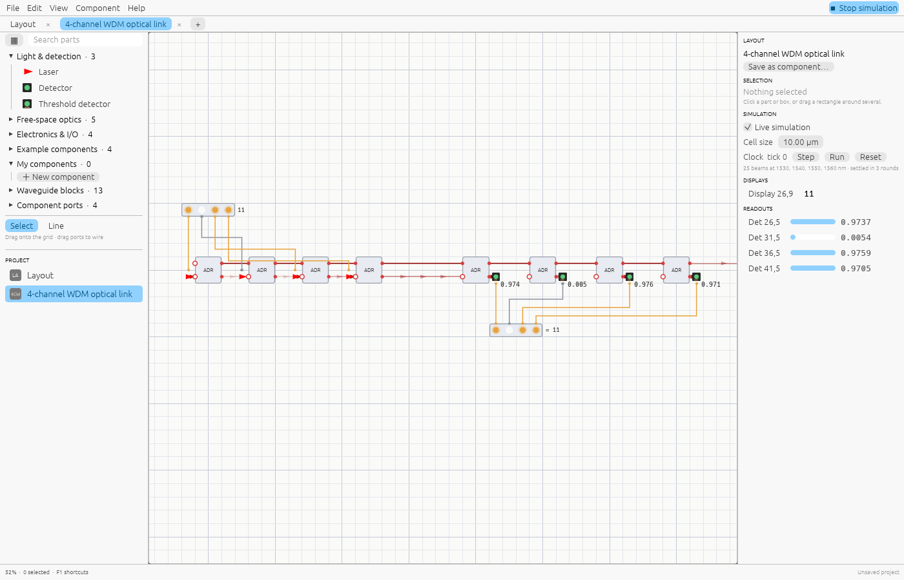

# Shine documentation

Shine designs and simulates photonic circuits: free-space optics on a bench, waveguide
components on a chip, and the electronics that drive and read them. It runs in the
browser at [shine.lupyd.com/app](https://shine.lupyd.com/app), as a desktop app on
Linux, Windows and macOS, as a Rust library, and as an MCP server for AI assistants.

## Guides

| Guide | What it covers |
|---|---|
| [Getting started](getting-started.md) | Install or open Shine, tour the window, run your first simulation |
| [Editing](editor.md) | Placing, selecting, moving, the add menu, the parts browser, keyboard and mouse |
| [Parts reference](parts.md) | Every part and block: what it does, its ports and parameters |
| [Wiring light and signals](wiring.md) | Waveguides, beams, signal wires, and converting between light and signals |
| [Components](components.md) | Turning a layout into a reusable box, ports and pins, trying a component on its own |
| [Electronics and the clock](electronics.md) | Number inputs, displays, registers, the clock, and function-cell expressions |
| [Sweeps](sweeps.md) | Spectra and parameter sweeps of any design, plotted and exported as CSV |
| [Examples](examples.md) | The ready-made circuits and what each one teaches |
| [How the simulation works](simulation.md) | What is solved exactly, what is modelled simply, and the limits |
| [Other tools and tapeout](interop.md) | S-parameters for circuit simulators, and a gdsfactory layout for a mask |
| [Projects and files](files.md) | The `.shine` format, the browser and desktop builds, logging |
| [AI assistants (MCP)](ai.md) | Using Shine from Claude and other MCP clients; notes for LLMs |
| [Rust library](library.md) | Using the `photonics` crate without the editor |
| [Development](development.md) | Building, testing, keeping these docs current, releases |
| [Roadmap](roadmap.md) | What's being built for 0.1.0 and what comes after |
| [Changelog](changelog.md) | What changed in each version |

On the website, **Search** at the top of every docs page (Ctrl+K) searches all of them.

For language models, the whole documentation is also served as plain text at
[`/llms.txt`](https://shine.lupyd.com/llms.txt) (an index) and
[`/llms-full.txt`](https://shine.lupyd.com/llms-full.txt) (everything in one file).
