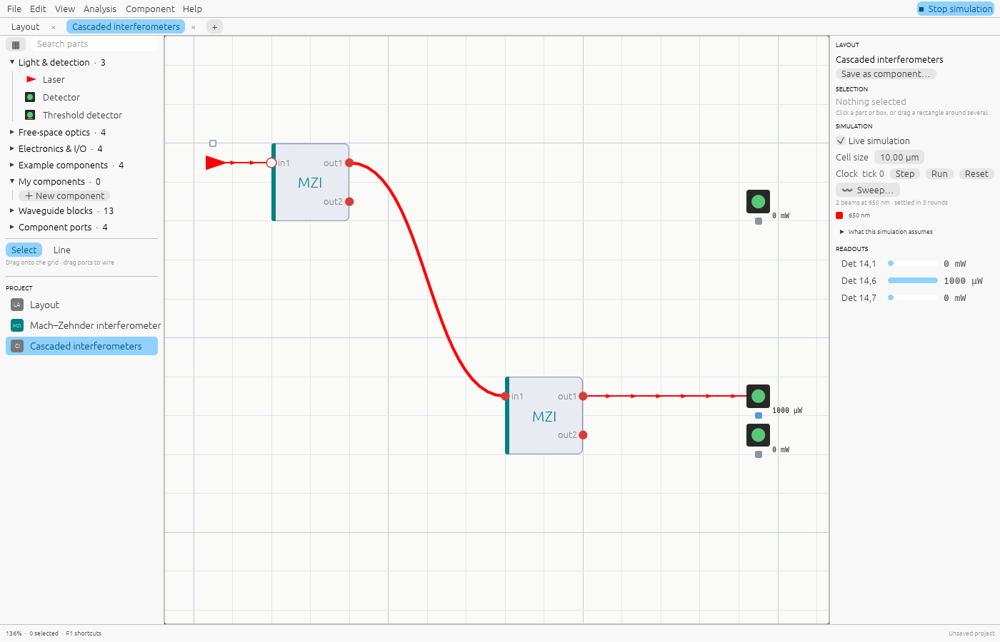
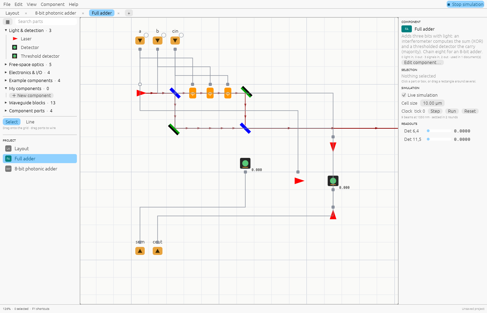

# Components

Any layout can become a **component**: a box you can place in other layouts, as many
times as you like. Edits to the component's layout update every place it's used.

## Making one

- **＋ New component** (library → *My components*, the parts browser, or the **+** tab
  button) creates a component with one light input and output and one signal input and
  output, and asks for its name, initials and description.
- Or turn any open layout into one: **Component → Save as component…**

The box shows the **initials**; hovering it shows the **description** and its ports.

## Ports and pins

What the box exposes comes from port parts inside the layout:

| Inside the layout | On the box | Order |
|---|---|---|
| Input port | light input, left edge | top to bottom |
| Output port | light output, right edge | top to bottom |
| Signal in | signal terminal, top edge | top to bottom, then left to right |
| Signal out | signal terminal, bottom edge | top to bottom, then left to right |

Name each port in the inspector (for example `a`, `b`, `cin`); the names show on the box
and in tooltips. Without names they are `in1…`, `out1…`, `s1…`, `q1…`.

An Input port injects light travelling in its arrow's direction; an Output port reads
the light that reaches it. Signal in outputs the value arriving at the box; Signal out
takes a value and passes it out of the box.

## Opening a component

Select a box and press **Tab**, or double-click it, to open its layout in a tab. The
inspector shows where it's used. You can't place a component inside itself, directly or
through other components.

## Trying a component on its own

In a component's own tab nothing drives its Signal in pins, so they read 0. **Click a
Signal in pin** to switch it between 0 and 1; a lamp next to it shows the value and the
simulation follows. This lets you test, for example, the Full adder's truth table
without building anything around it. These test values aren't saved and don't affect
the component where it's used.

## Managing components

In the **Project** list (left, below the library), right-click a document to open,
rename, edit its component details, or delete it. **Component → Stop sharing as
component** turns it back into a plain layout. A component that is still used somewhere
can't be deleted or unshared until its boxes are removed.
