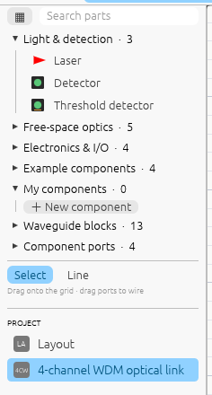
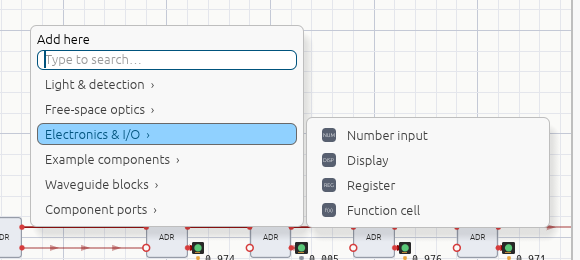
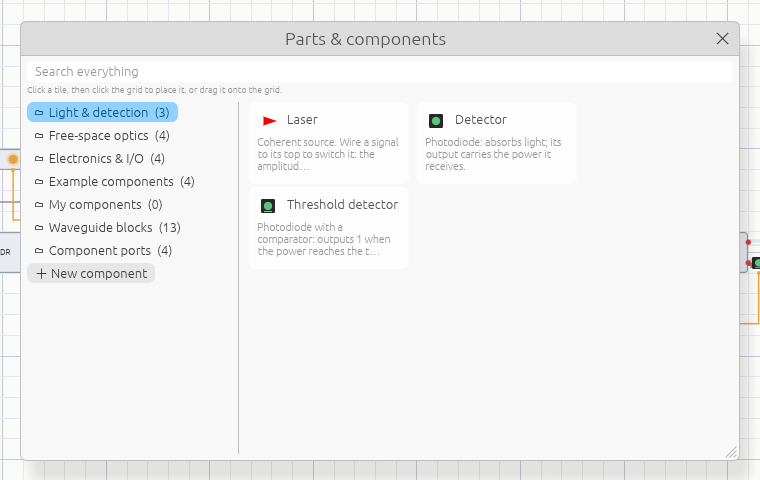

# Editing

The controls follow Blender's conventions. Press **F1** (or **?**) in the app for the
full list.

## The grid

Everything sits on a square grid. Free-space parts (lasers, mirrors, detectors…) take
one cell and are drawn as themselves. Built-in blocks and components are **boxes** that
take several cells: light ports on their left and right edges, signal terminals on the
top and bottom edges. The **cell size** (Inspector → Simulation, 10 µm by default) sets
the physical distance light travels between cells, which matters for interference.

## Adding parts

There are four ways, all placing into the cell you point at:

- **Drag** a row from the library onto the grid.
- **Click** a library row, then click the grid (repeat to place more; Esc stops).
- **Shift+A** (or right-click empty space) opens the **add menu** at the cursor.
- The **parts browser** (▦ next to the library search).

### The library

Parts are grouped into folders: *Light & detection*, *Free-space optics*,
*Electronics & I/O*, *Example components*, *My components*, *Waveguide blocks* and
*Component ports*. Click a folder to open or close it. Typing in the search box shows
matching parts from every folder in one list.

### The add menu

Hover a category to open its parts beside it, then click one. Or just start typing:
the menu turns into a search, and **Enter** adds the first match. Scrolling over the
menu scrolls the menu, not the grid. **Esc** or a click on the grid closes it.

### The parts browser

The browser shows every part as a tile with its description, folder by folder. Click a
tile and then click the grid, or drag the tile onto the grid. **＋ New component** starts
a [component](components.md).

## Selecting, moving, deleting

- **Click** selects; **Shift+click** adds or removes; **drag on empty space** draws a
  selection box. Clicking a waveguide or signal wire selects it.
- **Drag** a part or box to move it, or press **G** and move the mouse (**X** / **Y** lock
  the axis, click or Enter confirms, right-click or Esc cancels). Parts can't be dropped
  onto occupied cells.
- **R** / **Shift+R** rotate lasers by 90° and mirrors and splitters by 45°.
  Double-clicking a part rotates it too.
- **Shift+D** duplicates the selection (with the wires between the copies) and starts
  moving it.
- **X** or **Delete** removes the selection, or the selected wire.
- **Ctrl+Z** / **Ctrl+Shift+Z** undo and redo.

## Navigating

- **Wheel** or **pinch** zooms at the cursor; **trackpad scrolling** and **middle-drag**
  pan; **Ctrl+wheel** / **Shift+wheel** pan sideways / up and down; **Ctrl+middle-drag**
  zooms.
- **Home** frames everything; **.** (period) frames the selection.

## Preferences

**Edit → Preferences…** sets how Shine looks and behaves, and is remembered between
sessions (a settings file on desktop, the browser's storage on the web):

| Setting | Options |
|---|---|
| Theme | System, light or dark |
| Grid, port names | Show or hide the grid and the names on component boxes |
| Light colours | Real colours where visible (infrared and ultraviolet in distinct false colours), a distinct colour per wavelength, or one colour; use lasers' own colours |
| Channels | Draw each wavelength on a waveguide or beam as its own strand |
| Beams, readings | Direction arrows; detector powers on the canvas |
| Power in | mW (with µW, nW or W as fits) or dBm, for readings and laser power |
| New lasers | Their wavelength, typed or from presets |
| Simulation | Live simulation for new documents; clock speed |

## Keyboard and mouse reference

| Keys | Action |
|---|---|
| Middle drag / Shift+Middle drag | Pan |
| Ctrl+Middle drag | Zoom |
| Wheel / pinch | Zoom at cursor |
| Trackpad scroll | Pan |
| Home | Frame all |
| . (period) | Frame selected |
| Left click | Select |
| Shift+Left click | Extend / toggle selection |
| Left drag on empty space | Box select (Shift extends) |
| Left drag on component | Move it |
| Double click | Rotate a part / open a component |
| Click a number's bit | Toggle that bit |
| A / Alt+A / Ctrl+I | Select all / none / invert |
| G | Grab (move); X / Y constrain axis |
| Enter / Left click | Confirm grab |
| Esc / Right click | Cancel grab |
| R / Shift+R | Rotate clockwise / counter-clockwise |
| Shift+D | Duplicate and move |
| X / Delete | Delete selected |
| Shift+A / Right click | Add menu / context menu |
| Tab / Double click | Open a component's definition in its own tab |
| Drag from a port or terminal | Wire it: light ports take waveguides, square terminals take signals |
| Ctrl+Z / Ctrl+Shift+Z | Undo / redo |
| Space | Toggle simulation |
| T / N | Toggle toolbar / properties |
| Ctrl+N / Ctrl+O / Ctrl+S | New / open / save |
| F1 / ? | This help |
