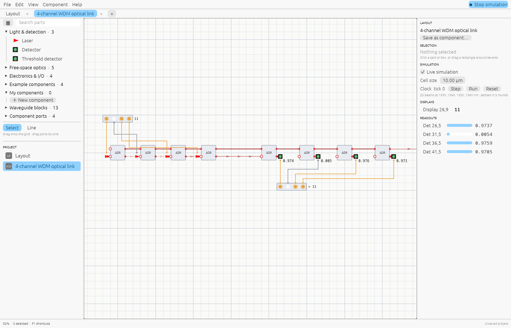
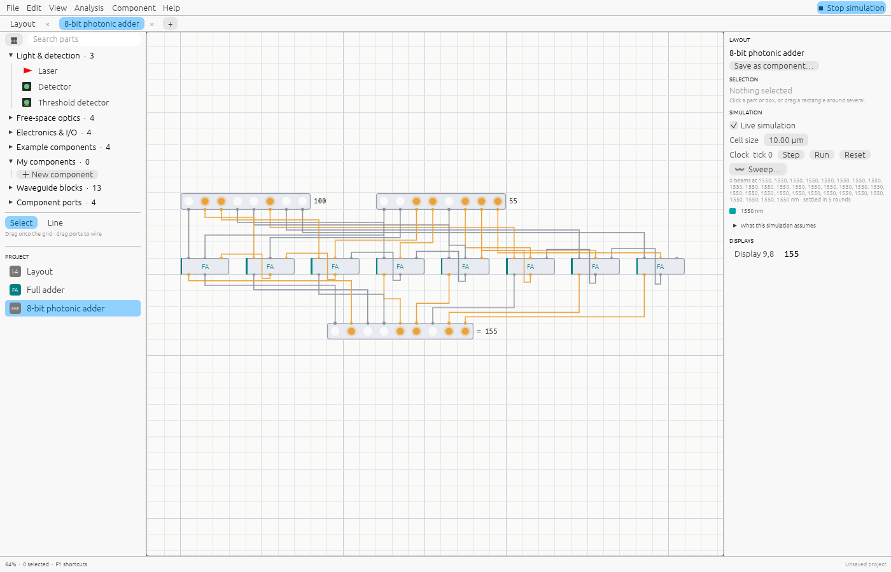
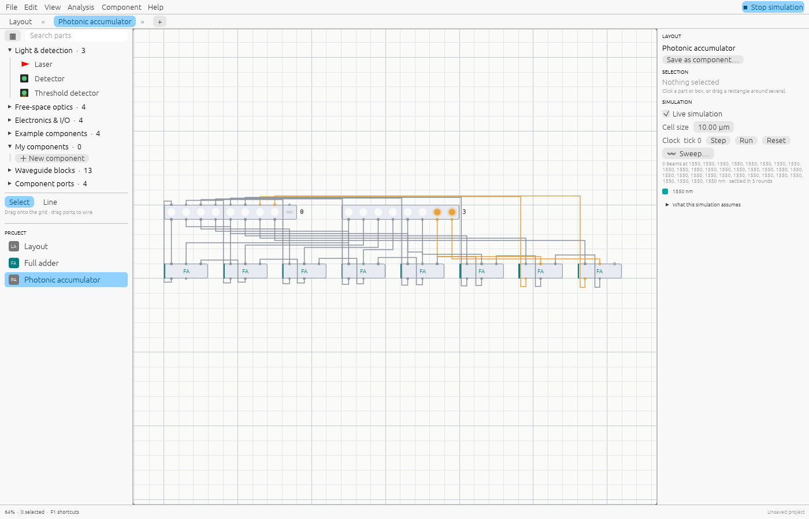
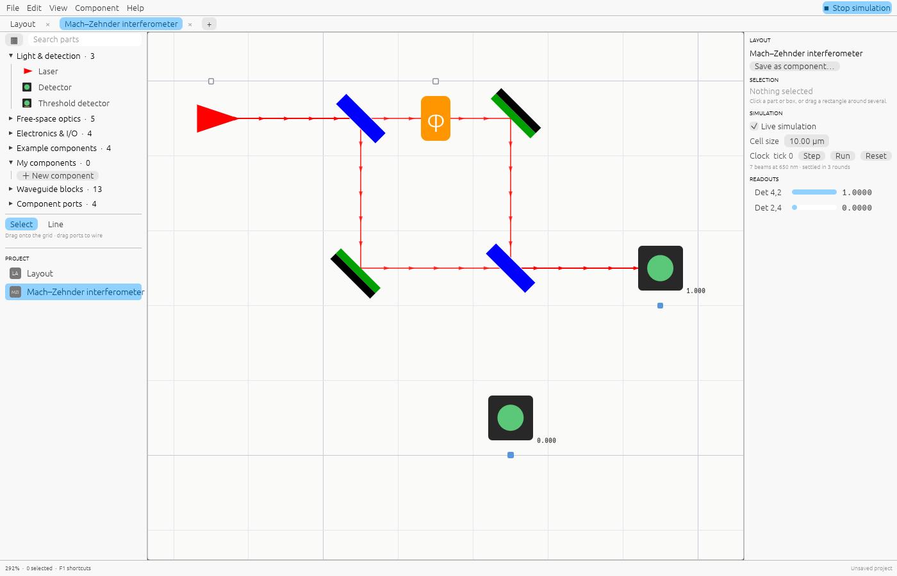
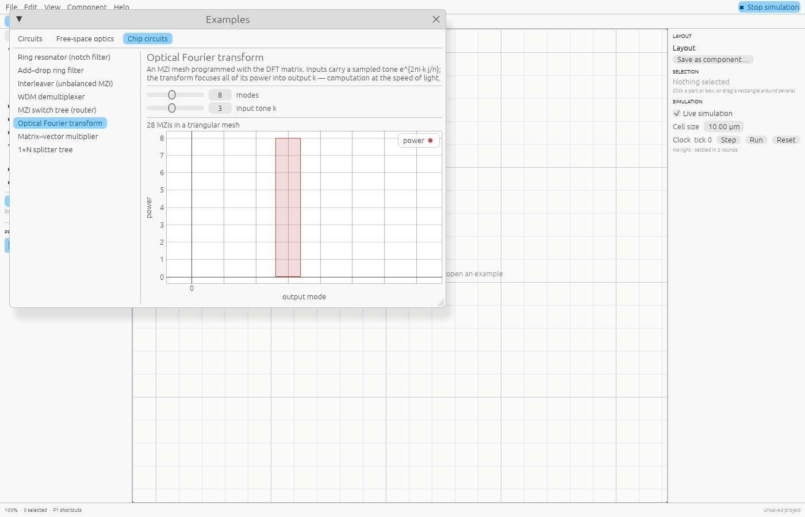

# Examples

Open them with **File → Examples…**, or link straight to one:
`https://shine.lupyd.com/app/?example=<name-with-dashes>`.

## Circuits

### 4-channel WDM optical link

What photonic chips do in data centres today. Four bits switch lasers at 1530, 1540,
1550 and 1560 nm. Add–drop rings tuned to each wavelength put them on one waveguide;
identical rings at the receiver drop each colour onto a threshold detector, and a display
shows the number received. Real transceivers run each wavelength at 25–100 Gb/s.

Try: click the input bits; or select the first receiver ring and change its length
slightly. It stops matching its laser, and that bit is lost.

### 8-bit photonic adder

Eight Full adder components with chained carries add two 8-bit numbers. Each full adder
computes its sum bit by interference (the input bits drive phase shifters in a
Mach–Zehnder) and its carry with a threshold detector.

How realistic: an **electro-optic teaching model**. Computing XOR by interference is a
real technique, but here every stage converts back to electronics; research chips keep
the carry in light and detect only at the end. In practice photonics is used for data
links and linear algebra, not digital arithmetic. Press Tab on a full adder to see its
optics, and click its pins to try it alone.

### Photonic accumulator

A register feeds eight full adders whose sums feed back into the register: each clock
tick adds the step (3) to the running total, wrapping at 256. Press **Step** or **Run**.

### 16×16 photonic matrix processor

The core of programmable photonic processors, the chips behind optical neural-network
accelerators and optical signal processing, at a realistic size: a 16×16 mesh of 120 MZIs,
1 410 parts once every component is opened up. A 1550 nm laser is split 16 ways; **the 16
bits on the left** each switch a modulator on or off, setting the input vector; the mesh,
programmed as the discrete Fourier transform, multiplies it; **the 16 detectors on the
right** show the result, with their readings.

It starts with the bits 1100 1100 1100 1100, a square wave, so the 1st, 5th and 13th
detectors light up and the rest stay dark: an optical FFT.

Try: click the bits (one bit on gives a flat spectrum; all on lights only the first
detector); press Tab on the mesh to look inside; export the mesh's S-parameters or SAX
netlist. It is also Shine's [reference design](reference-design.md): how we measure what
Shine can do with a large design.

### Cascaded interferometers

A free-space Mach–Zehnder saved as a component and used twice: a beam enters the first
box, and a waveguide joins it to the second.

## Free-space optics

| Example | Shows |
|---|---|
| Mach–Zehnder interferometer | A beam split into two arms and recombined; the phase shifter steers all the light between two detectors. The basic switch and modulator of photonic chips. |
| Michelson interferometer | Both arms fold back on mirrors, so light crosses the phase shifter twice: π/2 already darkens the detector. Used for precise length measurement. |
| Fabry–Pérot cavity | Two 90% mirrors form a resonator that transmits everything on resonance; nudge the wavelength or cell size to fall off it. |
| Coherent XOR gate | Two lasers on shared source A carry bits in their phase (0 or π); after a π/2 bias and a splitter, one detector reads a XOR b and the other XNOR. Put one laser on its own source and the interference disappears. |
| 1→4 fan-out tree | Three 50:50 splitters share one laser equally over four detectors. |

## Chip circuits

The *Chip circuits* tab explores waveguide circuits with sliders and a spectrum or power
plot:

| Example | Shows |
|---|---|
| Ring resonator (notch filter) | A ring beside a bus removes the wavelengths that fit around it; critical coupling makes the notch go to zero. |
| Add–drop ring filter | A ring between two waveguides moves its resonant wavelength to the drop port. |
| Interleaver (unbalanced MZI) | Unequal arms send alternate wavelengths to alternate outputs. |
| WDM demultiplexer | Rings tuned to four channels separate them onto four outputs. |
| MZI switch tree (router) | Cascaded MZI switches route one input to any of several outputs. |
| Optical Fourier transform | An MZI mesh programmed with the DFT matrix focuses a tone into one output. |
| Matrix–vector multiplier | Two MZI meshes and attenuators multiply a vector by any matrix (SVD). |
| 1×N splitter tree | Y-splitters share one input equally over N outputs. |

