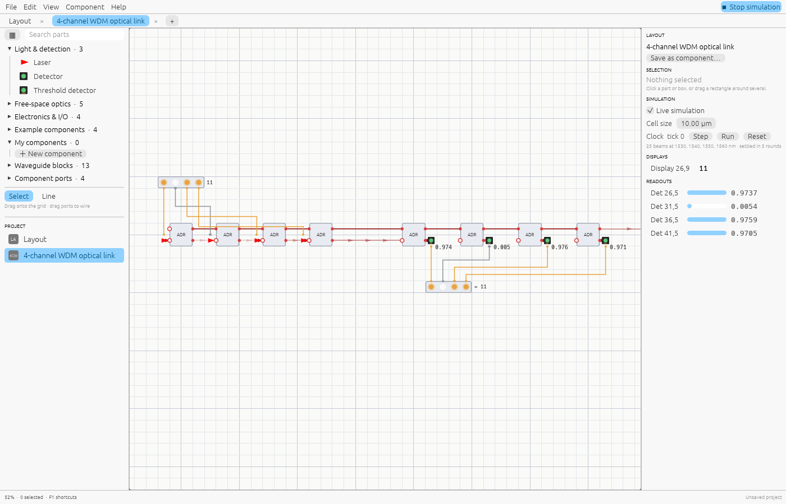

# Getting started

## Open or install

- **Browser:** open [shine.lupyd.com/app](https://shine.lupyd.com/app). Nothing to install;
  your work stays in the page until you download it (File → Save).
- **Desktop (faster):** download for your system from
  [shine.lupyd.com](https://shine.lupyd.com/#download) or the
  [GitHub releases](https://github.com/ash-hashtag/shine/releases): Linux (x86-64, ARM64),
  Windows (x86-64) or macOS (Apple silicon, Intel). Unpack it and run `shine`
  (`shine.exe` on Windows). The desktop app uses every CPU core and your processor's
  vector instructions, where the browser runs on one core, and it saves files directly.
  The archive also contains `shine-mcp`, the server for AI assistants (see
  [AI assistants](ai.md)).
- **From source:** `cargo run --release` (Rust 1.88 or newer).

## The window

- **Menu bar** (top): File, Edit, View, Component, Help, and the **Simulate / Stop
  simulation** switch on the right. Simulation is on by default and updates as you edit.
- **Tabs**: one per open document. A project can hold many layouts; components are layouts
  too, and open in their own tab.
- **Library** (left): parts in folders, a search box, and ▦ to open the
  [parts browser](editor.md#the-parts-browser). Below it, the **Project** list of every
  document.
- **Canvas** (middle): the grid where you place parts and wire them.
- **Inspector** (right): the selected item's settings and readings, simulation settings,
  the clock, displays and detector readouts.
- **Status bar** (bottom): zoom, the cell under the cursor, hints and messages.

## Your first circuit: a laser and a detector

1. Drag **Laser** from *Light & detection* onto the grid. It points right.
2. Drag **Detector** to a cell a few cells to the right of the laser, on the same row.
3. A beam appears and the detector reads `1.000`, the laser's power.
4. Drag a **Beam Splitter** between them. The beam splits; the detector now reads `0.500`
   and the reflected half leaves the splitter at 90°.
5. Press **R** with the splitter selected to rotate it 45°, or **G** to move it.

Hover a beam to see its wavelength, power and phase.

## Open an example

File → Examples… lists ready-made circuits. Start with these:

- **4-channel WDM optical link**: what photonic chips do in data centres today.
  Click the input bits and they arrive at the receiver.
- **8-bit photonic adder**: a teaching model of logic with light.
- **Mach–Zehnder interferometer**: interference on a free-space bench.

See [Examples](examples.md) for what each one shows.

## Next

- [Editing](editor.md) explains the mouse and keyboard controls.
- [Wiring light and signals](wiring.md) explains the two kinds of connection.
