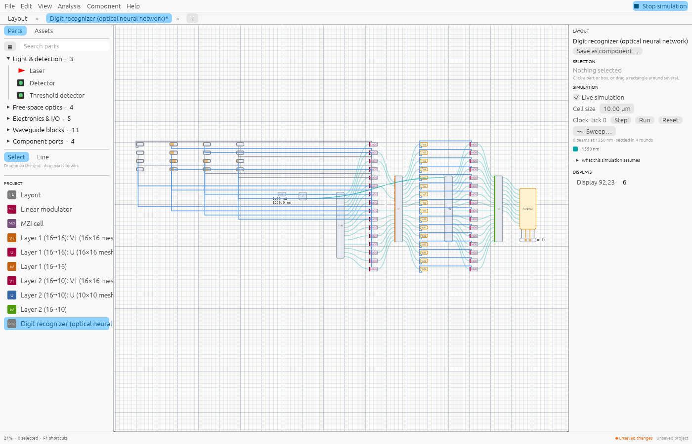
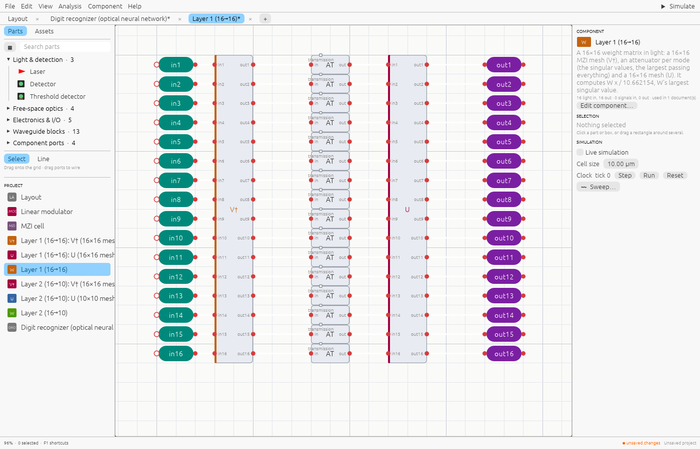

# An optical neural network that reads handwritten digits

Most of the work in running a neural network is multiplying vectors by matrices, and a mesh
of Mach–Zehnder interferometers does that with light in the time light takes to cross the
chip. This example is a complete small inference chip built that way: a two-layer optical
neural network that reads handwritten digits. Shine simulates all of it, light, detectors
and electronics together. Open it with **File → Examples… → Digit recognizer (optical
neural network)**.

It reads **93.6%** of 450 handwritten digits it was never trained on correctly, the same
as the trained network. An electronic network of the same size reads 92.0%.

To put a network of your own on a chip, see [Your neural network on a photonic
chip](photonic-neural-networks.md).

## Using it

Light and data flow left to right:

1. **The digit** is the 4×4 grid of value inputs at the top left: a handwritten digit
   shrunk to 16 pixels, each from 0 (blank) to 1 (ink), as a filled bar. Each shows the
   light it lets into the first layer. Click along a bar to change a pixel.
2. **The laser** (*LS*) is split in two (*Y*), and each half 16 ways (*1×N*): one set of 16
   lights for each layer.
3. **Layer 1**: 16 linear modulators put the pixels on the lights; the layer (*W*)
   multiplies them by a trained 16×16 matrix.
4. **Neurons**: 16 photodetectors with electronics (*ƒ n1* … *ƒ n16*) read the layer's
   outputs and turn each power into a drive, clamp(gain × power, 0, 1): the network's
   nonlinearity.
5. **Layer 2**: the neurons drive 16 more modulators on the laser's other half; the layer
   multiplies by a trained 10×16 matrix, one output per digit.
6. **Readout**: electronics (*ƒ argmax*) find the brightest of the 10 outputs and the
   display shows it: the digit the chip read.

Press Tab on a layer to see inside it, and Tab again on its meshes and MZI cells.

## How it is built



| Part | What it is | Size |
|---|---|---|
| **Linear modulator** | A push-pull Mach–Zehnder modulator with its driver: the driver sets the two arms' heaters to ±(π/2 − asin v), so the field out is exactly v times the field in, with no change of phase | 9 blocks |
| **Layer** | A weight matrix W as W = U Σ V†: a mesh of MZIs for V†, an attenuator per output for Σ (the largest passing everything), a mesh for U. Both meshes are in the rectangular (Clements) arrangement, with balanced paths | Layer 1: 2 × 120 MZIs; layer 2: 120 + 45 MZIs |
| **Neuron** | A function cell reading light: a photodetector, gain and clamp, driving the next modulator | |
| **Chip** | 16 pixels, 32 modulators, 2 layers, 16 neurons, readout and display | 4 698 parts, 465 MZIs |



The network was trained (`reference/digits/train.py`, with JAX) on exactly what the chip
computes:

```text
h     = clamp(|W1 x|² / H, 0, 1)    layer 1, photodetectors, neurons
o     = |W2 h|²                      layer 2, photodetectors
digit = argmax(o)
```

So the weights suit the hardware: detection, which squares the field, is part of the
network rather than an error to correct. Shine builds the chip from the trained weights
(`src/panels/optics/digits.rs`): it decomposes each matrix into meshes, sets every heater
and attenuator, and works out the neurons' gain from the laser power and the losses along
the way.

## Checked three ways

Shine simulates the whole chip for each of the 450 test digits. Its 10 output powers are
compared with the trained network computed digitally, and the chip's two optical layers,
exported as SAX netlists, are run in two other simulators with the same electronics
around them (`reference/digits/compare.py`):

| | Digits read right | Same digit as Shine | Largest difference in the scores |
|---|---|---|---|
| Trained network (digital) | 421 / 450 (93.6%) | 450 / 450 | 9 × 10⁻¹¹ |
| Shine, the whole chip simulated | 421 / 450 (93.6%) | | |
| SAX 0.16, the layers' netlists | 421 / 450 (93.6%) | 450 / 450 | 9 × 10⁻¹¹ |
| PhotonForge 2.1, the layers rebuilt from its own models | 421 / 450 (93.6%) | 450 / 450 | 9 × 10⁻¹¹ |

The differences are the rounding of the saved scores. How long each took, on a laptop
(AMD Ryzen 5 7430U), November 2026:

| | Time |
|---|---|
| Shine: both layers' matrices, from the design | 12 ms |
| Shine: the whole chip, light, detectors and electronics, for one digit | 25 ms |
| SAX: both layers' matrices | 3.5 s to build the circuits, 4.1 s to solve (2.8 s again) |
| PhotonForge: both layers' matrices | 8.7 s to solve (10 ms again, from its cache) |

SAX and PhotonForge simulate the optics only: the neurons and the readout ran in NumPy
around their matrices. Shine simulates the electronics too, as part of the circuit.

To run the comparison yourself:

```sh
cargo run --release --example digits -- --export out --scores out/shine.json
pip install sax photonforge
python reference/digits/compare.py out reference/digits/test-digits.json --photonforge
```

## At full size

The same chip scales to 28×28 pictures: 784 pixels, 784 modulators, and a layer 1 whose
V† mesh has 784 modes, 306 936 MZIs. Opened up, the chip has **3 124 074 parts**. It's
Shine's stress test, and the reason Shine handles designs of millions of parts.

The one in the repository, `reference/mnist/fashion-mnist-chip.shine`, is trained on
**Fashion-MNIST**: 70 000 pictures of ten kinds of clothing (T-shirt/top, trouser,
pullover, dress, coat, sandal, shirt, sneaker, bag, ankle boot), in MNIST's format. Its
network (784 → 64 → 10, trained for the chip's electronics as above) reads **87.96%** of
the 10 000 test pictures. The same tools train it on MNIST's handwritten digits instead
(97.40%).

```sh
pip install numpy jax
python reference/mnist/train.py CACHE [--dataset fashion|mnist]   # downloads the data into CACHE, trains, writes the weights there
shine network CACHE/weights.json --out chip.shine                 # the chip, from the weights
```

From a checkout of Shine's source, `cargo run --release --example mnist -- CACHE
[--images N] [--editor]` also simulates the whole chip for test pictures, runs the whole
test set through its layers and times the editor on it: Shine's stress test.

Simulated whole (light, detectors and electronics), the chip reads each picture as the
network does, its scores within 10⁻¹⁰ of the network's; through its layers' matrices,
all 10 000 test pictures come out as the network's.

### Classifying your own pictures

Give `examples/mnist.py` pictures (PNG, JPEG and the like, any size, a dark thing on a
light background or the other way round; it needs Pillow):

```sh
pip install pillow
python examples/mnist.py --image shoe.png [more.png ...]
```

The script prepares each picture as the dataset's were (Fashion-MNIST's items cropped,
fitted to 28×28 and centred; with `--dataset mnist`, MNIST's digits fitted in 20×20 and
centred by their centre of mass) and runs the `shine` program on the chip with the 784
pixel values on its standard input (`shine simulate … --input -`, see
[Command line](command-line.md#inputs)); it finds `shine` on the PATH, or in `SHINE` or
`--shine`. It shows the 28×28 the chip sees, the light at each class's detector and the
class the chip's display shows. Several pictures go through one run, the meshes solved
once: about 3.5 s for the first and a tenth of a second for each after. To run `shine`
yourself, `--print-inputs` prints just the numbers:

```sh
python examples/mnist.py --image shoe.png --print-inputs | shine simulate reference/mnist/fashion-mnist-chip.shine --input -
```

The chip opens in the app as any project does (`shine reference/mnist/fashion-mnist-chip.shine`).

### Benchmarks

The chip in the repository, run with the `shine` program on a laptop CPU (AMD Ryzen 5
7430U: 6 cores, 12 threads, 14 GB), every picture simulated whole: light through 3.1
million parts, the 64 photodetector neurons and their electronics, the second layer, the
readout. From `python reference/mnist/benchmark.py --images 1000`:

| | |
|---|---|
| One picture (opening the 15.6 MB chip, solving its meshes, simulating) | 3.5 s |
| … each picture after that, in the same run | **112 ms** (9 a second) |
| 1 000 pictures in one run | 116 s |
| Peak memory | 689 MB |
| The same network computed directly (NumPy, for scale) | 4 µs a picture |

Against the trained network (its weights are in the repository too,
`reference/mnist/fashion-mnist-weights.json`), on all 10 000 test pictures
(`--images 10000`):

| | |
|---|---|
| Accuracy | **87.96%**, the trained network's |
| The network's class | **10 000 of 10 000** pictures |
| Scores, the largest difference from the network's | 8.4·10⁻¹⁵ of the largest (rounding) |

Building and editing it (from Shine's source: `cargo run --release --example mnist`):

| | |
|---|---|
| Building the chip from its weights (`shine network`) | 1.6 s |
| Layer 1's 64 × 784 matrix | 0.5 s |
| The editor on the chip, a frame (drawn and tessellated) | 3 ms |
| … inside the 784-mode mesh, seen whole / at 15% | 17 ms / 21 ms (panning 9 / 12 ms) |

A simulated picture takes 112 ms where NumPy computes the same answer in 4 µs: the
simulator works out what every waveguide, detector and electronic block does, which is
what lets the same design be checked against the physics, exported to SAX or a layout,
and taped out. On the chip itself, the answer would take as long as light takes to cross
it.

What makes that possible, rather than minutes and tens of gigabytes:

- **Passive components are solved once.** A component of only passive parts is, to the
  light, its matrix. Shine solves it into that matrix, all the way down: each MZI cell
  becomes a 2×2 matrix, on all threads at once, then the mesh of them one 784×784 matrix.
  The matrices are kept between simulations until the component changes, so a new picture
  costs only what's around the meshes.
- **Solving keeps only the fields still needed.** A mesh's fields are each read once, by
  the next MZI, so solving its matrix holds a few kilobytes per input instead of tens of
  megabytes.
- **The editor costs what's on screen.** Drawing and pointing go through a spatial index,
  and nothing per frame reads the whole project.

Fashion-MNIST (Han Xiao, Kashif Rasul and Roland Vollgraf, Zalando Research, 2017) is
under the MIT licence; the chip made from it ships with Shine. MNIST (LeCun, Cortes and
Burges) is under CC BY-SA 3.0, so neither its digits nor a chip trained on them are kept
in the repository. What's still to do for designs this size (projects as indexed
databases, loading only what's used, smaller designs in memory) is on the
[Roadmap](roadmap.md#milestone-design-at-scale).

## How realistic it is

- **The architecture is real.** Programmable MZI meshes with optoelectronic neurons
  (detect, compute the nonlinearity electronically, modulate again) are how coherent
  optical neural networks are built and demonstrated in research.
- **The components are ideal**: lossless 50:50 couplers, perfect heaters, a fixed
  waveguide loss, no noise, no fabrication error. On a real chip, meshes need calibrating,
  detectors add noise and the electronics have limited precision.
- **It is small.** 16 inputs means each digit is a 4×4 thumbnail (the [full-size
  version](#at-full-size) takes 28×28); real accelerators use larger meshes and
  many layers, and keep the weights in the mesh while streaming inputs
  at gigahertz rates through the modulators.
- **The data**: the network is trained and tested on the UCI handwritten digits (Alpaydin
  & Kaynak, 1998, CC BY 4.0), the 8×8 digits that ship with scikit-learn. They are close
  in spirit to MNIST; MNIST's licence (CC BY-SA) would put share-alike conditions on the
  test digits kept in the repository.

To train it again: `pip install numpy jax scikit-learn`, then
`python reference/digits/train.py reference/digits` and
`cargo run --example digits -- --write`.
