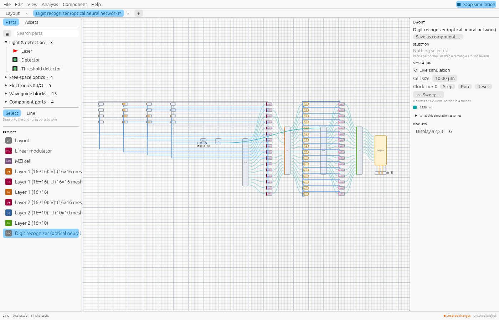
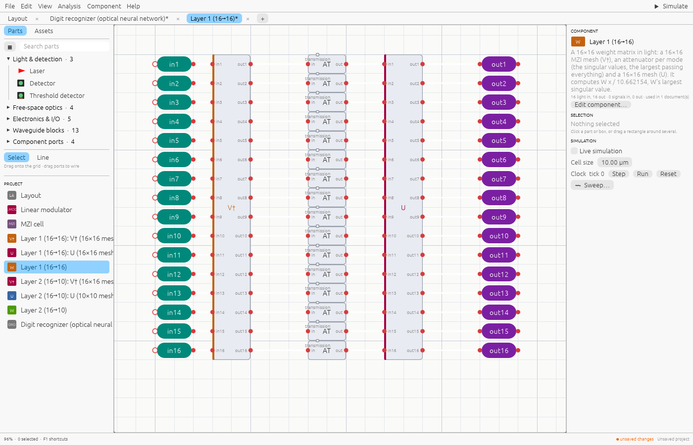
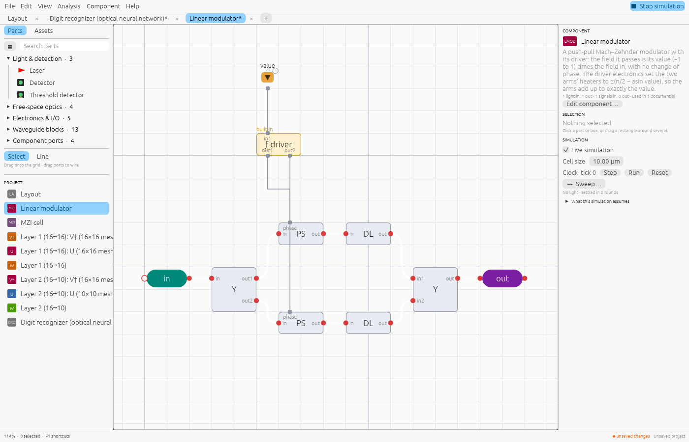

# Your neural network on a photonic chip

This guide takes a neural network from training to a photonic chip you can simulate,
inspect and export: the same path as Shine's [optical neural networks](neural-network.md),
for your own data. It covers two-layer classifiers, which Shine builds for you from their
weights; [further on](#layers-on-their-own) is how to build layers one at a time for
anything else.



*Shine's digit recognizer, the chip this guide builds for your network, simulating: from
the left, the value inputs (the picture), the laser split into one light per input, the
modulators, layer 1, the neurons (amber: built-in electronics), layer 2's modulators,
layer 2, and the readout, whose display shows the digit it reads.*

## What becomes light, and what stays electronic

| In the network | On the chip | What it computes |
|---|---|---|
| The input values | A laser split into one light per input by a splitter tree, each through a **linear modulator** driven by a value input | Each light's field is its value, −1 to 1 |
| A linear layer W | A **weight layer**: two meshes of MZIs (W = U Σ V†) with an attenuator per mode between them | W x / σmax, σmax being W's largest singular value: light can't be amplified |
| The activation | A **photodetector** per neuron, and electronics (a function cell) | clamp(\|W₁ x\|² / H, 0, 1): the detector reads power, the square of the field |
| The output layer | A second weight layer, fed by modulators driven by the neurons, then detectors | \|W₂ h\|², one power per class |
| The prediction | Electronics that pick the largest power and show its index on a display | argmax |

So the network the chip runs is

```text
h = clamp(|W1 x|² / H, 0, 1)      W1: hidden × inputs
o = |W2 h|²                       W2: classes × hidden
class = argmax(o)
```

H is a fixed scale: the largest |W₁ x|² the network sees in training, so the neurons use
their whole range. What this means for your network:

- **Train it as the chip computes it**, square and clamp included (next section). A network
  trained with ReLU and then given these layers won't work.
- **No biases.** If you need one, add an input that is always 1: a bias is then a column
  of W.
- **Inputs from −1 to 1.** Scale your data to that range (pictures are usually 0 to 1).
- **Signs are fine.** Weights and fields can be negative (or complex); only the detectors
  square them.

## 1. Train for the chip

Any framework works if the forward pass is the one above. In PyTorch:

```python
h = torch.clamp((x @ W1.T) ** 2 / H, 0, 1)
o = (h @ W2.T) ** 2
logits = t * o / (o.sum(dim=1, keepdim=True) + 1e-9)    # t: a learned temperature
loss = torch.nn.functional.cross_entropy(logits, labels)
```

Set H from the data as you train (`H = ((x @ W1.T) ** 2).max()` over a few thousand
training samples, once an epoch), and once more over the whole training set at the end.
Shine's own training script, [`reference/mnist/train.py`](https://github.com/ash-hashtag/shine/blob/main/reference/mnist/train.py)
(JAX), does exactly this for 28×28 pictures and is a starting point to copy: it gets
87.96% on Fashion-MNIST with 64 neurons.

## 2. Save the weights

Write them as JSON, in a folder of their own as `weights.json`:

```json
{
  "w1": [[0.9, -0.4, 0.2, 0.1, -0.6], [0.3, 0.8, -0.5, 0.4, 0.2], [-0.2, 0.1, 0.7, -0.9, 0.5]],
  "w2": [[1.0, -0.5, 0.3], [-0.4, 0.9, 0.6]],
  "hidden_scale": 1.5,
  "classes": ["no", "yes"]
}
```

`w1` is hidden × inputs and `w2` classes × hidden, a row per neuron; `hidden_scale` is H.
`classes` (the classes' names), `dataset` (what it was trained on, which names the chip)
and `test_accuracy` are optional.

## 3. Build the chip

```sh
$ shine network FOLDER/weights.json --out chip.shine
Wrote “Optical neural network” to chip.shine: a 5 → 3 → 2 network on 17 MZIs. Its 5 inputs, in order: shine simulate chip.shine --inputs
```

It builds any two-layer network of this kind, of any size (layers may widen or narrow): a
5 → 3 → 2 network takes a few milliseconds, a 784 → 64 → 10 one (3.1 million parts)
under two seconds. `--name` names the chip; `shine network --help` has the details. The
chip has the value inputs in a square grid (for pictures,
row by row), the laser, splitter trees and modulators, the two weight layers as components
(their meshes components of their own), a function cell per neuron, and a display showing
the class.

## 4. Run it

The chip's inputs are its value inputs, in order; `--inputs` lists them and `--input`
sets them from numbers, a sample per line (see [Command line](command-line.md#inputs)):

```sh
$ shine simulate chip.shine --inputs
5 inputs, in the order --input sets them:
     1  value at 0,0  now 0
     2  value at 8,0  now 0
…
$ printf '1 0 0.5 0 0.2\n0 1 0 0.8 0\n0.3 0.3 0.9 0 1\n' |
    shine simulate chip.shine --input - --box-outputs --only "Layer 2" --only Display
sample,"Layer 2 (3→2) 78,8 out1 (mW)","Layer 2 (3→2) 78,8 out2 (mW)","Display 84,15"
1,0.016860605369414194,0.0019010891724680404,0
2,0.00454019458214211,0.04708272257333522,1
3,0.005069707081064153,0.013366735913576212,1
```

Each row is a sample: the light leaving the second layer for each class (in mW), and the
class the display shows. In the app, open `chip.shine`, press **Space** to simulate, and
set the inputs by clicking along the value inputs; the display shows the class.

For pictures, [`examples/mnist.py`](neural-network.md#classifying-your-own-pictures)
prepares an image as 28×28 values and runs `shine` on the chip with them.

## 5. Check it against your network

The chip's powers are your network's o times one common factor (the laser's power, the
splitting and the layers' σmax and losses), so their ratios, and the class, should match
exactly. For the samples above:

```python
import json
w = json.load(open("FOLDER/weights.json"))
for x in ([1, 0, 0.5, 0, 0.2], [0, 1, 0, 0.8, 0], [0.3, 0.3, 0.9, 0, 1]):
    h = [min(1, max(0, sum(a * b for a, b in zip(row, x)) ** 2 / w["hidden_scale"])) for row in w["w1"]]
    o = [sum(a * b for a, b in zip(row, h)) ** 2 for row in w["w2"]]
    print(o, o.index(max(o)))
```

```text
[0.2767, 0.0312] 0        chip: 0.016861 / 0.001901 = 8.87, network 8.87, both class 0
[0.0745, 0.7728] 1        chip: 0.0964, network 0.0964, both class 1
[0.0832, 0.2194] 1        both class 1
```

For a big network, run the test set through the chip in one go (one `--input` stream, a
line per sample: the meshes are solved once, then each sample takes a fraction of a
second) and count where the classes differ. For Shine's 28×28 chip, they never do.

## Layers on their own



*Inside a weight layer: the V† mesh, an attenuator per mode (the singular values) and
the U mesh. The inspector says what it computes, with σmax.*

For other shapes (more layers, other activations, a layer inside a bigger design) build
each weight matrix as a component and wire the rest yourself:

- in the editor, **Component → New layer from a matrix…** (paste the matrix or read it from
  a file; it shows the size, MZIs and σmax before making it);
- on the command line, `shine layer W1.txt --out chip.shine --name "Layer 1"`;
- in code, `project.new_weight_layer("Layer 1", matrix)` in Python, TypeScript or Rust
  ([Python](python.md#matrices-as-light)).

Each layer computes W x / σmax (`layer_scale` gives σmax), with inputs `in1`… and outputs
`out1`…. Between layers, a neuron is a function cell with one light input, whose
expression is the activation on the detected power `p1` (for example
`clamp(p1 * 2.5, 0, 1)`), driving a modulator on fresh light for the next layer
([Electronics](electronics.md)).



*The linear modulator each input and neuron drives: a push-pull Mach–Zehnder whose
driver (the amber function cell) sets the two heaters to ±(π/2 − asin v), so the light
it passes is exactly v times the light in.* `shine network` builds the two-layer chip with the same blocks; its code, in Shine's
repository (`src/panels/optics/digits.rs` and `src/panels/optics/layers.rs`), is the
complete example to follow.

## Towards hardware

A chip built this way exports like any design: S-parameters, a SAX netlist and a
gdsfactory layout ([Other tools and tapeout](interop.md)). Its components are ideal:
[How realistic it is](neural-network.md#how-realistic-it-is) says what a real chip adds
(calibration, detector noise, the electronics' precision) and what to check before
taping one out.
