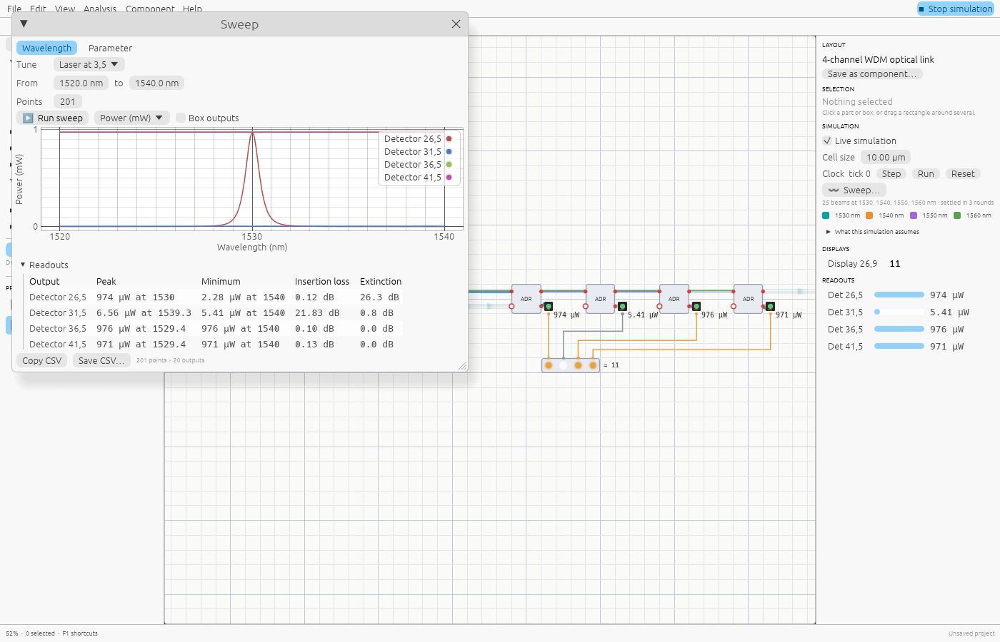

# Sweeps

A sweep simulates your design many times while one thing changes, and plots the power at
every output. Use it for spectra (a ring's resonance, a filter's passband, a WDM link's
channels) and for tuning (how a phase shifter steers an interferometer, where a coupler
reaches critical coupling).

## Opening a sweep

- **Inspector → Simulation → Sweep…**: sweeps the selected part, or the first laser.
- **Right-click** a laser, phase shifter, attenuator, beam splitter or a waveguide block →
  **Sweep…**
- **Analysis → Sweep…** in the menu bar.

Selecting a laser sets up a wavelength sweep around its wavelength; selecting anything else
sets up a parameter sweep over its first parameter.

## Wavelength sweeps

Pick the laser to tune and the range in nm. The laser steps through the range; everything
else stays as it is. This is how a tunable laser measures a device's spectrum.

## Parameter sweeps

Pick a part (**Use selection**) and one of its parameters, and the range:

| Part | Parameters |
|---|---|
| Laser | power (mW), phase, wavelength |
| Beam splitter | reflectivity |
| Phase shifter | phase |
| Attenuator | transmission |
| Directional coupler | coupling |
| Phase shifter / attenuator blocks | phase / loss (dB) |
| Delay line | length, n_eff, n_g, loss (dB/cm) |
| MZI switch | θ, φ |
| Ring, add–drop ring | coupling, length, n_eff, n_g, loss (dB/cm) |
| A component's box | the parameters its component [exports](components.md#parameters) |

## Reading the plot

Every detector and output port is a curve, named by its label or its position. Tick **Box
outputs** to also plot the light leaving every block and component (`Add–drop ring 24,4
out2`); they're shown anyway when a design has no detectors. Click a name in the legend to
hide or show it.
The **Plot** menu shows **Power (mW)**, **Power (dBm)**, or **Relative to input (dB)**: each
output over the input power, which is the tuned laser's for a wavelength sweep and all
lasers' for a parameter sweep. That's the transmission spectrum engineers quote. Scroll to
zoom and drag to pan the plot; double-click resets it.

## Readouts

Under the plot, a table gives for every curve shown:

| Readout | What it is |
|---|---|
| Peak | highest power, and the swept value where it occurs |
| Minimum | lowest power, and where |
| Insertion loss | input over peak power, in dB: what the best path loses |
| Extinction | peak over minimum, in dB: how deep the switching or notch is |
| FSR | wavelength sweeps: the free spectral range, the mean spacing of the resonances |
| Width | wavelength sweeps: full width of the strongest resonance at half its depth (dips) or height (peaks) |
| Q | wavelength sweeps: the quality factor, the resonance's wavelength over its width |

In the add–drop ring example, the drop port's insertion loss is about 0 dB at resonance,
and the through port's extinction is over 20 dB.

A resonance is wherever a curve goes past halfway between its lowest and highest power:
dips on a ring's through port, peaks on its drop port (hover the FSR for how many were
found). Its width needs both its sides inside the sweep and a few points across it, so a
narrow resonance shows *–* until the sweep has enough points: for a ring of Q 10 000 at
1550 nm (0.16 nm wide), use steps of 0.05 nm or less. The values follow the textbook ring:
FSR = λ²/(n_g·L), and the width and Q from the coupling and loss.

Each point is a full simulation: light and electronics settle together, and components are
simulated through. Coarse sweeps (tens of points) are instant; thousands of points on a big
design take a few seconds.

## Exporting

**Copy CSV** puts the data on the clipboard, ready to paste into a spreadsheet. **Save
CSV…** writes a file (in the browser, it downloads). The first column is the swept value;
then one power column (mW) per output. **Save image…** saves the plot as a PNG image.

A link can open a sweep directly: `?example=4-channel-wdm-optical-link&sweep` opens the
example and runs a sweep of its first laser.
